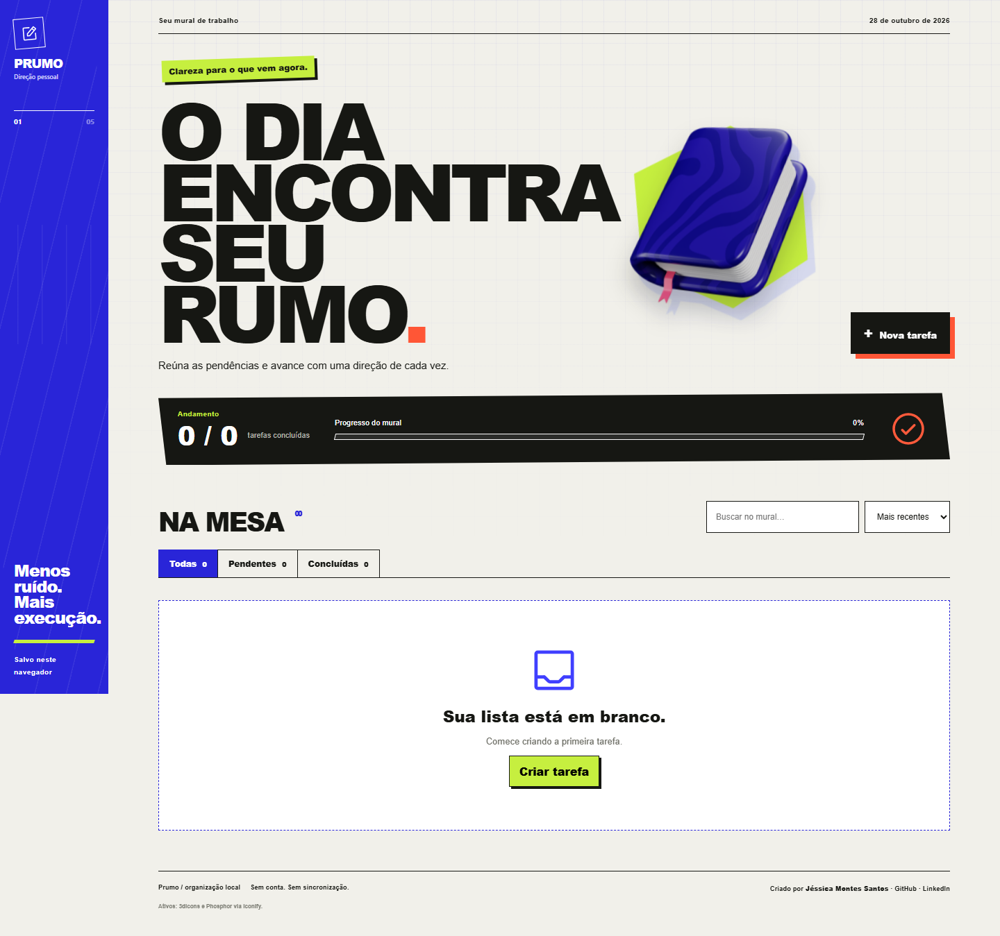

# Prumo — gerenciador de tarefas

Aplicação estática, sem dependências. Abra `index.html` no navegador.

## Funcionalidades
- Criar, editar, concluir e excluir tarefas.
- Prioridade, notas, data limite, filtros de status, pesquisa e ordenação.
- Indicador de progresso e persistência com `localStorage`.
- Atalhos: `N` cria tarefa; `Ctrl/⌘ + K` foca a busca.

## Estrutura
- `index.html`: interface e formulário acessível em `dialog`.
- `style.css`: apresentação responsiva.
- `core.js`: regras puras e validações testáveis.
- `app.js`: eventos, renderização e persistência.

Os dados pertencem ao navegador/dispositivo atual. Limpar os dados do site apaga os registros. Não há sincronização.
